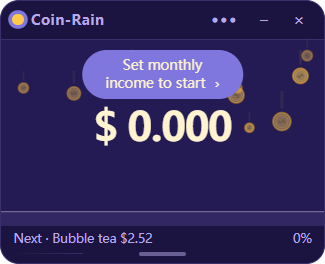

# Coin-Rain

A tiny, always-on-top Windows desktop widget that turns your monthly income into a never-ending coin rain. Enter a number once, hide it forever, and watch the balance tick up second by second while you work, rest, or simply stare at the screen.

> **Developed with [WorkBuddy](https://www.workbuddy.cn/), powered by Tencent Hunyuan Hy4.**
> This project was designed, implemented, debugged, localized and packaged in an agentic coding workflow driven by the **Hunyuan Hy4** large language model inside WorkBuddy.



## Highlights

- **Coin rain with a purpose.** Coins fall straight down, melt into the filled part of the progress bar, or get pulled through a little tube into it on the unfilled side.
- **Money that never stops.** A timestamp-driven running total grows every second at a rate derived from the monthly income you entered.
- **Immersive by default.** After a few seconds of inactivity the title bar slides away and the rain fills the whole widget; move the pointer back and it returns.
- **First-run setup.** A small wizard asks for language and currency before the rain starts. Defaults are **English** and **US Dollar**.
- **4 languages** — English, Simplified Chinese, Traditional Chinese, Japanese.
- **13 currencies** — CNY, USD, EUR, GBP, JPY, HKD, TWD, KRW, SGD, AUD, CAD, INR, CHF — with built-in offline reference rates.
- **4 themes, 3 particle shapes**, adjustable density, fall speed, effects, cheer frequency and idle delay.
- Mini window, resizable height (drag the bottom grip), tray menu, always-on-top and keep-screen-awake options.

## Privacy

Privacy is a design constraint, not an afterthought:

- **No login, no account, no network requests.** The app works fully offline.
- **Your monthly income is never stored.** Only the derived per-second rate, the workday/hour basis and the running total are saved locally.
- **No offline catch-up.** The total is computed from timestamps while the app is running; closing the app does not silently add earnings for the time it was closed.
- Currency conversion uses a static, built-in reference table for demonstration only. It is **not** live FX data and must not be used for payroll, accounting or trading.

## Getting started

### Run the packaged build

A ready-to-run Windows build is produced by `npm run pack` under `dist/win-unpacked/Coin-Rain.exe`. Windows installers (NSIS) and an MSIX/AppX package can be produced with `npm run dist:win` / `npm run dist:appx`.

> The AppX manifest in `package.json` contains placeholder `publisher` / `publisherDisplayName` values. Replace them with your own Partner Center publisher identity before submitting to the Microsoft Store. Store packages are re-signed by Microsoft and are not meant for local sideloading; use `build/appx-local-test.json` together with `build/sign-local-appx.ps1` to create a self-signed local test package.

### Run from source

Requires Node.js 18+ and Windows (Electron desktop build).

```bash
npm install
npm start
```

`npm start` launches Electron through `start.js`, which clears an inherited `ELECTRON_RUN_AS_NODE` variable that would otherwise start Electron in Node-only mode.

Useful scripts:

| Command | What it does |
| --- | --- |
| `npm start` | Run the widget from source |
| `npm run check` | Syntax-check all JavaScript entry points |
| `npm run pack` | Build `dist/win-unpacked` |
| `npm run dist:win` | Build the NSIS installer |
| `npm run dist:appx` | Build the Microsoft Store AppX package |
| `npm run dist:appx:localtest` | Build and sign a sideloadable local test package |

## Project layout

```
main.js                 Electron main process, window, tray, config IPC
preload.js              Safe contextBridge API for the renderer
start.js                Development launcher
renderer/index.html     Widget markup + first-run wizard + in-app dialog
renderer/style.css      Themes, immersive transitions, overlays
renderer/app.js         Coin particles, progress bar, config, interactions
renderer/locale.js      All 4 languages, 13 currencies, offline FX table
build/                  Icons, AppX assets and local-test signing helpers
```

Configuration is stored in the Electron `userData` folder (pinned to `coin-rain` so the running total survives product renames) and mirrored in `localStorage`.

## A note on the in-app dialogs

The widget deliberately avoids `window.confirm()`. Under a frameless, always-on-top Electron window a native synchronous modal can be hidden behind the widget and does not restore keyboard focus to the renderer, which makes every input look frozen. All confirmations are rendered inside the page instead, and focus is explicitly handed back afterwards.

## Acknowledgements

- Built with [WorkBuddy](https://www.workbuddy.cn/) and the **Tencent Hunyuan Hy4** large language model.
- Built on [Electron](https://www.electronjs.org/) and [electron-builder](https://www.electron.build/).
- Made by **ZanYu Studio**.

## License

[MIT](LICENSE) © 2026 ZanYu Studio.
